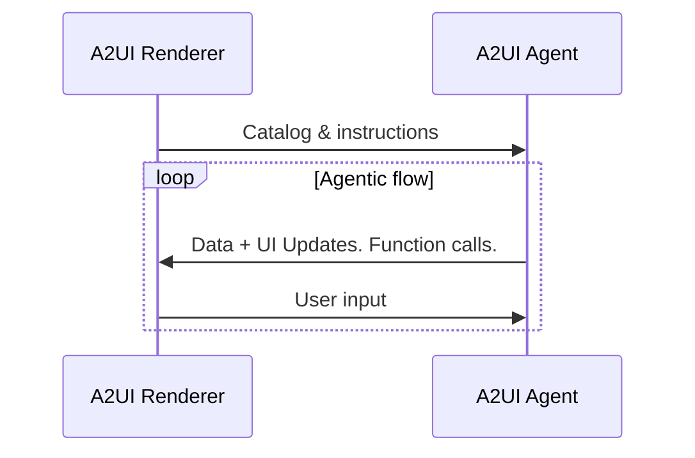
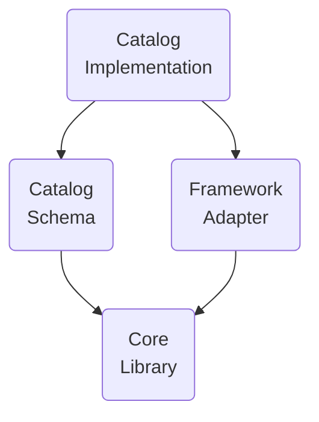

# A2UI OPERATING RULES

## Architecture facts (non-negotiable)
- A2UI uses an ADJACENCY LIST. Components are a flat array with ID references.
  Children come from `explicitList` or `template` in the envelope — NEVER from
  markup inside a component's own template.
- If you write a Lit element whose template renders another custom element,
  STOP. That is nesting. It is the wrong model.
- Structure lives in components. Content lives in the data model.
  Use { "path": "/x/y" }, not literals.

## Three layers, always distinguish them
1. CATALOG (catalog.json) = JSON Schema. Validation only. No templates,
   no bindings, no layout. Server-emitted shapes get validated here.
2. REGISTRY (tag-registry.ts) = resolution allowlist. Name → tag + declared
   events. Unregistered tags fail silently at runtime.
3. RUNTIME (Lit shadow DOM) = assembly. This is where composition happens.
   Sub-pieces are internal to a parent element unless the model must emit
   them independently.

### Where the three layers are — THE LIT CATALOG

| layer | file |
|---|---|
| CATALOG — what the server accepts | `frontend/src/components/A2UI/catalogs/<pipeline>/catalog.json` |
| REGISTRY — what may be rendered | `frontend/src/shared/tag-registry.ts` |
| RUNTIME — what draws | `frontend/src/components/lit/<element>.ts` |
| RESOLVER — name → tag | `frontend/src/components/lit/a2ui-renderer.ts` |

`primitives` is the shared floor: each theme's catalog must carry its definitions
byte-identical, and the checker fails when a theme drifts from it.

**The resolver decides in this order, and only in this order** (`resolveTag`):
`COMPOSITE_MAP` → A2UI primitives (the six the renderer owns) → structural composites →
the allowlist (`pascalToKebab`). `COMPOSITE_MAP` exists because a catalog name can be an
EXISTING element under a different name — `ChatPanel` is `chat-panel`, `CompiledOutput` is
`compiled-output-viewer` — and folding the casing would produce a tag that resolves to
nothing. A name nothing claims resolves to `null` and is REPORTED, never guessed: a guess
draws an empty box and the failure then looks like styling.

**One component, three files** — plus the import in `frontend/src/main.tsx` (an element
never imported is never defined, and an undefined tag draws an empty box with no error),
and the catalog's SECOND entry under `$defs.anyComponent.oneOf`, which `schema-unreachable`
catches when it is missed. `READ-ME/ADDING-A-CATALOG-ELEMENT.md` is the checklist.

## Verification before completion (hard gate)
Never report "done" based on DOM structure, token matching, or tests passing.
Behavior first, pixels last:
1. Round-trip: send → POST succeeds → turn appears in thread.
2. Every interactive control dispatches its event (log each detail).
3. Drag/resize controls actually change dimensions.
4. Only then compare visual output to Figma.
If any step fails, report FAIL with the error. Do not proceed to styling.

## Capability honesty
- Figma MCP returns geometry, fills, typography. It does NOT return dev-mode
  annotations (Data:/On click:/Failure:) and cannot render pixel images back.
- When you cannot verify something, say so and stop. "I cannot confirm X" is
  a correct and complete answer. Plausible output is not.
- Never fill a gap with a decorative stand-in. An absent feature must be
  reported as absent, never drawn as decoration.

## Corrections are violations
If the design lacks a control, render it absent and report the absence.
Do NOT add controls, buttons, inputs, or panels to make a feature work.
A chat that cannot accept input is a CORRECT result if the frame has no input.
Inventing missing pieces is a protocol violation, not help.
Report: "The design has no X — add it in Figma, then I'll render it."

## Contract stability (labels vs contracts)
- Node labels and tag names are the STABLE identifiers — they anchor structure
  across design edits. Paint edits change nothing upstream.
- The BREAKABLE surface is properties and event payloads. Additive only:
  adding a property is safe; renaming one, or changing an event's detail
  shape, breaks every consumer silently — the same signature as an
  unregistered tag (structure intact, data path severed, no error).
- A deleted element leaves dangling `explicitList` ID references, which render
  NOTHING at that position — a silent hole, not a crash. When a rendered
  surface has an ID reference that resolves nowhere, report it loud.

## Chat seat identity: two kinds, never interchangeable

HOST SEAT (console operator shell)
- Mounted directly by WritingAreaIndex.tsx, NOT emitted by an A2UI surface.
- No conversation-id attribute. Reads global/session usage.
- Aggregates across all activity: catalog assembly, health checks, console runs.
- Owns: trace feed, global token totals, model info for the session.

SURFACE SEAT (prompt package chat)
- Emitted inside the A2UI surface as part of an assembled envelope.
- MUST have conversation-id + session-id attributes present and non-null.
- Aggregates ONLY calls made within this conversation_id.
- Forbidden: reading session totals, importing console state, displaying
  any call not attributed to this conversation.

DISCRIMINATOR (check in this order):
1. Is the element a descendant of the A2UI surface host? → SURFACE SEAT
2. Does it carry a non-null conversation-id?        → SURFACE SEAT
3. Neither true?                                     → HOST SEAT

If a surface seat cannot resolve its own conversation_id, render tokens
as "unattributed" rather than falling back to session totals. Never
display another scope's numbers.

## Known failure pattern (happened 6 times on 2026-09-16)
Every incident had the same shape: complete-looking output, required piece
missing, success reported anyway. Silent fallbacks, buried inputs, unassigned
Figma nodes, styled shells with no handlers, empty surface containers.
Countermeasure: when something looks finished but nothing responds, the
interior is missing. Check the data path before touching styles.

**IT HAPPENED AGAIN ON 2026-09-30, IN SEVEN DIFFERENT WAYS, AND THE SHAPE HELD.** The account is in
[`THE_ZERO_TRUST_REPAIR.md`](THE_ZERO_TRUST_REPAIR.md) — five traps inside the ingest (a capability
claimed that did not exist, facts dropped by a hand-written key list, a loop that could never
execute and whose comment said it did, a measurement read by nothing, a second code path for one
layer) and two meta-traps that matter more: **a guard that survived only as records in a log while
its code was in no commit**, and **an instrument that lied five times before it was right once**.
Read it before touching the ingest, the fidelity proof, or any allowlist in a measurement path.

Use A2UI with Any Agent Framework & Harness¶
A2UI is a declarative UI format. AG-UI is the transport that carries A2UI messages between an agent and an app. Use this guide to add A2UI to an AG-UI app or harness backed by ADK, LangGraph, Mastra, Strands, CrewAI, Google Chat, Slack, or any other agent framework or service that supports AG-UI.

The examples below use AG-UI-compatible runtime tooling so you can focus on the A2UI surface: enabling the renderer, giving your agent a catalog, and streaming UI updates back to the user. For protocol-level setup and concepts, see the AG-UI docs.

Agent skills¶
If you are using a coding agent to wire this up, load the AG-UI ag-ui-a2ui-integration skill before it modifies your app. It covers AG-UI framework adapters, supported create-ag-ui-app flags, transport setup, A2UI runtime and renderer wiring, and end-to-end verification for AG-UI + A2UI apps.

If your app uses CopilotKit for A2UI rendering, also load the CopilotKit copilotkit skill for CopilotKit v2 runtime, provider, theme, and catalog conventions.

1. Set up AG-UI¶
Start from the agent framework you already use, then add an AG-UI runtime connection between the agent and your app. The runtime streams agent events, including A2UI messages, to the client surface.

Use the AG-UI CLI to scaffold an AG-UI app with the client and agent framework you want:

npx create-ag-ui-app@latest
You can also start directly from supported framework templates:

npx create-ag-ui-app@latest --adk
npx create-ag-ui-app@latest --langgraph-py
npx create-ag-ui-app@latest --langgraph-js
Strands has no scaffold flag yet — wrap an existing Strands agent (see the Strands panels below).

The important part is the transport contract: your app receives AG-UI events and routes A2UI payloads to an A2UI renderer. Some scaffold paths use CopilotKit's A2UI runtime with Next.js under the hood, but the setup surface stays AG-UI-first.

2. Set up your agent or harness¶
The A2UI steps are the same across frameworks: connect your agent to AG-UI, enable A2UI payloads, and render those payloads in the app. Start with the framework or harness you already use. The snippets below come from the corresponding AG-UI integrations and show the framework-native agent shape that AG-UI wraps.

ADK
LangGraph (Python)
LangGraph (FastAPI)
LangGraph (TypeScript)
Strands (Python)
Strands (TypeScript)
Slack
Use ADK when your agent already runs on Google's Agent Development Kit. The AG-UI ADK middleware exposes the agent as an AG-UI event stream:

from fastapi import FastAPI
from ag_ui_adk import ADKAgent, AGUIToolset, add_adk_fastapi_endpoint
from google.adk.agents import Agent

my_agent = Agent(
    name="assistant",
    instruction="You are a helpful assistant.",
    tools=[
        AGUIToolset(),  # Adds tools provided by the AG-UI client.
    ],
)

agent = ADKAgent(
    adk_agent=my_agent,
    app_name="my_app",
    user_id="user123",
)

app = FastAPI()
add_adk_fastapi_endpoint(app, agent, path="/chat")
See the AG-UI ADK middleware.

These snippets establish the AG-UI server connection. Slack uses the same AG-UI/A2UI contract through its own harness and client bridge. The next sections turn on A2UI rendering, catalogs, and component definitions inside the app surface.

3. Enable A2UI¶
Start from the developer experience you want: define the catalog definitions the agent can see, map each definition to a renderer, create the catalog, and pass that catalog into CopilotKit. The frontend catalog config is the target A2UI activation surface.

import {CopilotKit, CopilotChat} from '@copilotkit/react-core/v2';
import {
  createCatalog,
  type CatalogDefinitions,
  type CatalogRenderers,
} from '@copilotkit/a2ui-renderer';
import {z} from 'zod';

// catalog definitions — describe the building block components to the agent
export const catalogDefinitions = {
  Card: {
    description: 'A titled card container.',
    props: z.object({title: z.string(), subtitle: z.string().optional()}),
  },
  PrimaryButton: {
    description: 'A styled primary button.',
    props: z.object({label: z.string(), action: z.any().optional()}),
  },
} satisfies CatalogDefinitions;

// catalog renderers — how each primitive renders in the DOM (React, in this example)
export const catalogRenderers = {
  Card: MyCard,
  PrimaryButton: MyPrimaryButton,
} satisfies CatalogRenderers<typeof catalogDefinitions>;

// definitions + renderers together define a catalog declaration
const catalog = createCatalog(catalogDefinitions, catalogRenderers, {
  catalogId: 'my-catalog',
  includeBasicCatalog: true,
});

<CopilotKit runtimeUrl="/api/copilotkit" a2ui={{catalog}}>
  <CopilotChat />
</CopilotKit>;
Passing a catalog to the provider auto-enables A2UI and injects the generate_a2ui tool, so your agent can produce surfaces with no extra runtime config (CopilotKit ≥ 1.61.2). You can opt out, or opt in manually without a catalog, by configuring the runtime directly:

app/api/copilotkit/route.ts

import {CopilotRuntime} from '@copilotkit/runtime';

const runtime = new CopilotRuntime({
  agents: {default: myAgent},
  a2ui: {injectA2UITool: true},
});
Scope to specific agents with a2ui: { injectA2UITool: true, agents: ["my-agent"] }. For fixed-schema flows where your agent already returns a2ui_operations, a2ui: true or a2ui: {} is enough.

Custom components (BYOC)¶
A2UI ships with a built-in catalog (Text, Image, Card, …) that gets you a working surface immediately. The expanded BYOC flow below shows the same catalog pattern split across files for a real app:

Definitions: Zod schemas plus a natural-language description. This is what the agent sees in its system prompt. Note that for client-side functions, the client determines the function's execution boundary (such as clientOnly status) at runtime by reading its configuration from the active catalog definition.
Renderers: Typed React components, one per definition. This is what the user sees.
Registration: Pass the catalog through the provider so the A2UI renderer knows how to draw your components.
1. Define component schemas¶
Create platform-agnostic definitions with Zod. The description field gets injected into the agent's prompt so the LLM knows when to reach for each component; the schema validates the props the agent sends.

lib/a2ui/definitions.ts

import {z} from 'zod';

export const myDefinitions = {
  StatusBadge: {
    description: 'A colored status badge.',
    props: z.object({
      text: z.string(),
      variant: z.enum(['success', 'warning', 'error']).optional(),
    }),
  },
  Metric: {
    description: 'A key metric with label and value.',
    props: z.object({
      label: z.string(),
      value: z.string(),
      trend: z.enum(['up', 'down']).optional(),
    }),
  },
};

export type MyDefinitions = typeof myDefinitions;
2. Create React renderers¶
Map each definition to a React component. createCatalog is generic over the definitions type, so the props your renderer receives are type-checked against the Zod schema, so a typo in props.text is a compile error.

lib/a2ui/renderers.tsx

'use client';

import {createCatalog, type CatalogRenderers} from '@copilotkit/a2ui-renderer';
import {myDefinitions, type MyDefinitions} from './definitions';

const myRenderers: CatalogRenderers<MyDefinitions> = {
  StatusBadge: ({props}) => {
    const colors = {
      success: {bg: '#dcfce7', text: '#166534'},
      warning: {bg: '#fef3c7', text: '#92400e'},
      error: {bg: '#fee2e2', text: '#991b1b'},
    };
    const c = colors[props.variant ?? 'success'];
    return (
      
        {props.text}
      
    );
  },

  Metric: ({props}) => (
    

      
{props.label}

      

        {props.value} {props.trend === 'up' ? '↑' : props.trend === 'down' ? '↓' : ''}
      

    

  ),
};

export const myCatalog = createCatalog(myDefinitions, myRenderers, {
  catalogId: 'my-app-catalog',
  includeBasicCatalog: true, // merges with built-in components
});
catalogId is the stable handle the agent uses to target this catalog; includeBasicCatalog: true keeps the built-in components available alongside your own (omit it to render only your components).

3. Pass the catalog to CopilotKit¶
app/layout.tsx

'use client';

import {CopilotKitProvider} from '@copilotkit/react-core/v2';
import '@copilotkit/react-core/v2/styles.css';
import {myCatalog} from '@/lib/a2ui/renderers';

export default function Layout({children}: {children: React.ReactNode}) {
  return (
    <CopilotKitProvider runtimeUrl="/api/copilotkit" a2ui={{catalog: myCatalog}}>
      {children}
    </CopilotKitProvider>
  );
}
Agents will now see your custom components alongside the built-ins and can use them in any A2UI surface they emit.

For the full BYOC reference (multiple catalogs, theming hooks, advanced patterns), see CopilotKit's Custom Components (BYOC) section.

# Glossary

## A2UI protocol terms

Terms, required by A2UI protocol.

### A2UI agent and A2UI renderer

The A2UI protocol enables conversation between **agent** and **renderer**:

1. **Renderer** provides **UI capabilities** in the form of A2UI catalog and **instructions** on how to use it.
2. **Agent** iterates on the loop:
    - Provides **UI** and **functions** to call, taking into account the received catalog
    - Receives **user input**, communicated by renderer
    - Updates **data** to show in UI

While the protocol is designed for **AI-empowered agents**, it can work with deterministic agents as well. For example, an agent may return a pre-canned A2UI UI.

In case the agent is stateless or does not guarantee to preserve the catalog, the renderer should provide the catalog with every message.

And, sometimes, an agent is using a predefined catalog, thus forcing the renderers to either support this catalog or use an adapter.

### GenUI Component

UI component, allowed for use by agent. Examples: date picker, carousel, button, hotel selector.

### Catalog

1. Itemized renderer capabilities:
    - List of components that the agent can use to generate UI
    - List of functions that can be invoked by renderer
    - Styles and themes
2. Explanation on how the renderer capabilities should be used.

It is observed that depending on use case, catalog components may be more or less specific to domain:

- **Less specific**:

    Basic UI primitives like buttons, labels, rows, columns, option-selectors and so on.

- **More specific**:

    Components like HotelCheckout or FlightSelector.

### Basic Catalog

A catalog maintained by the A2UI team to get up and running quickly with A2UI.

See the [basic catalog](../../../specification/v0_9_1/catalogs/basic/catalog.json).

### Catalog Transformer

A rule set that programmatically filters, adapts, or mutates a pristine **Catalog** before system prompt instructions are generated or payload validation schemas are compiled.

#### Why Catalog Transformers are needed

While a catalog provides a complete specification of all UI components and functions supported by a renderer, agent implementations frequently need to prune or restrict the catalog for specific use cases:

- **Context Window Token Optimization**: A catalog can define dozens of components and logic functions. Injecting all component JSON schemas into an LLM's system prompt consumes significant context window tokens, increases prompt latency, and inflates LLM inference costs. Pruning transformers restrict system prompt instructions to only the subset of components relevant to that agent's domain task.
- **Task-Specific Capability Guardrails**: Specific agent workflows or security roles may require restricting interactive features (e.g. allowing display cards and text, but disabling form inputs or administrative components in guest mode).
- **Model Signature Reduction**: Pruning function rules and validation checks to produce compact prompt instruction blocks for smaller or micro LLMs.

#### Example catalog transformers

- `ComponentPruningTransformer`: a utility class that filters the catalog based on a list of allowed component names.

- `FunctionPruningTransformer`: a utility class that filters the catalog based on a list of allowed function names.

### Capabilities Object

Set of catalogs that are available for use. Through this set, agent or renderer advertises what it supports, so the other side knows what it may send.

For example, if a renderer supports Basic, Hotels and Flights catalogs, it will advertise them in its capabilities object.

A capabilities object is exchanged through transport metadata or an initialization payload, not as an [A2UI message](#a2ui-message). The exact placement is transport-specific.

The objects are named differently in earlier versions of the protocol: v0.9 and v0.9.1 call them client and server capabilities, and v0.8 defines only a client-side schema.

### Surface

An area of UI, constructed by A2UI agent and managed by the A2UI renderer,
which consists of a number of components. Surfaces cannot nest.

### A2UI Tag

Enclosing delimiter tags (such as `<a2ui-json>`, `<a2ui>`) used to bound A2UI payload code blocks within LLM text output.

Because LLMs stream conversational plain text and UI payloads within the same turn, A2UI Tags serve as explicit syntactic boundaries isolating structured UI blocks from conversational text.

### Tag Unwrapping

The initial phase of response parsing (`unwrap`) where a parser scans LLM text responses for opening and closing **A2UI Tags**, isolating non-UI conversational text (e.g., _"Here is your summary:"_) from enclosed raw UI code blocks.

### Compilation

The second phase of response parsing (`compile`) where raw model-generated UI code string blocks extracted during unwrapping (such as standard JSON, Express DSL syntax, or Elemental HTML tags) are parsed, decompiled, and transformed into standardized A2UI protocol payload dictionaries (`createSurface`, `updateDataModel`).

### Agent architecture

There are options for A2UI agent:

- **Same-process or server-side**:

    Agent and renderer may reside in one process of a client side application. Example: desktop Flutter application.

    Or, renderer may reside on the box that displays UI, and agent may reside on another box (server).

- **Orchestrator agent**:

    The central orchestrator manages interactions between a user and several specialized sub-agents. The orchestrator can be in the same process or on the server.

- **Pulling / pushing**:

    An agent can wait for messages/requests from the renderer, or push messages/requests to it.

- **Stateful / stateless**:

    Agents can preserve state or be stateless.

- **Mixed with other protocols**:

    A2UI can be used in combination with other protocols. For example, an agent may be an MCP and/or A2A server.

- **Something else**:

    In addition to the above options, there is possibility for any custom variation.

### Renderer stack

Functionality of A2UI renderer consists of layers that can be developed separately and reused:

- **Core Library**:

    Set of primitives, needed to describe catalog and to interact with the agent.

    For example, see the [JavaScript web core library](../../../renderers/web_core/README.md).

- **Catalog Schema**:

    Definition of catalog in the form of JSON.

    For example, see the [basic catalog schema](../../../specification/v0_9_1/catalogs/basic/catalog.json).

- **Framework adapter**:

    Code that implements the execution of the agent’s instructions in a concrete framework. For example:
    - JavaScript core and catalogs may be adapted to Angular, Electron, React and Lit frameworks.
    - Dart core and catalogs may be adapted to Flutter and Jaspr frameworks.

    See the [Angular adapter](../../../renderers/angular/README.md).

- **Catalog Implementation**:

    Implementation of the catalog schema for a framework.

    For example:
    - See the [Angular implementation of the basic catalog](../../../renderers/angular/src/v0_9/catalog/basic)

### A2UI message

A message between agent and renderer.

As the protocol allows streaming, any message can be finished (completely delivered) or not finished (partially delivered). A finished message may be completed (successfully delivered) or interrupted (delivery stopped because of some technical issues).

See the [data flow guide](data-flow.md).

### Agent turn

Set of messages sent by agent, before it starts waiting for user input.

### Data model

Observable, hierarchical, JSON-like object, shared between renderer and agent and updatable by both. Each Surface has a separate Data Model.

Components can be bound to nodes of the data model, in order to auto-update when the values are changed.

Data model allows bidirectional synchronization by capturing user interactions into a state object for transmission to the agent, while also allowing agent to push data updates back to the UI.

See the [data binding guide](data-binding.md).

### Data reference

In component definition, a reference to a data element, resolvable either by path in the data model or by value.

See the [example in the basic catalog](../../../specification/v0_9/catalogs/basic/catalog.json#L23).

### Client function

A function provided for agent to invoke when needed.

Do not confuse with LLM tool:

| Feature      | Client Function                                                       | LLM Tool Invocation                                                                   |
| ------------ | --------------------------------------------------------------------- | ------------------------------------------------------------------------------------- |
| Executor     | A2UI Renderer                                                         | LLM requests invocation without concern about execution details.                      |
| Timing       | After the agent to renderer message is sent.                          | Before the agent to renderer message is sent.                                         |
| Purpose      | UI logic (Validation, visible toggles, Formatting)                    | Reasoning, Data Fetching, Backend Actions                                             |
| Definition   | Registered in client side function registry and advertised in catalog | Defined in ToolDefinition (passed to LLM)                                             |
| State Access | Access to DataContext and Input values.                               | No access to trigger requests to AI. Access to external APIs, databases, and services |

See the [example in common types](../../../specification/v0_9_1/json/common_types.json#L200).

### Action

A container for an interaction triggered by the user in the UI. Actions come in two types:

- **Event**: Dispatched to the agent for processing (e.g., clicking "Submit").
- **Function**: Executed locally on the renderer (e.g., opening a URL).

See the [detailed guide on actions](actions.md).

## Generative UI terms

Terms, not required by A2UI protocol, but commonly used in the context of generative UI.

### Known patterns of GenUI

- **Chat**:

    Pieces of generated UI appear one by one, sorted by time, in a vertically scrollable area, mixed with user input.

- **Canvas**:

    Space for collaboration with an agent.

- **Dashboard**:

    Pieces of generated UI are organized not by time, but by their meaning and stay reliably (a.k.a. pinned) where the user expects to see them.

- **Wizard**:

    Pieces of generated UI are shown one by one, with the goal to collect necessary information for a certain task.

### NoAI information

Information, categorized as **not accessible by AI** (for example, credit card information).

Which information should not be accessible by AI is defined by owners of the application and it is **different in different contexts**. For example, in some contexts medical history should never go to AI, while in others AI is heavily used to help with medical diagnostics and thus needs medical history.

This term is important in the GenUI context, because end users want to **clearly see** what their input is allowed to go to the AI and what is not allowed.